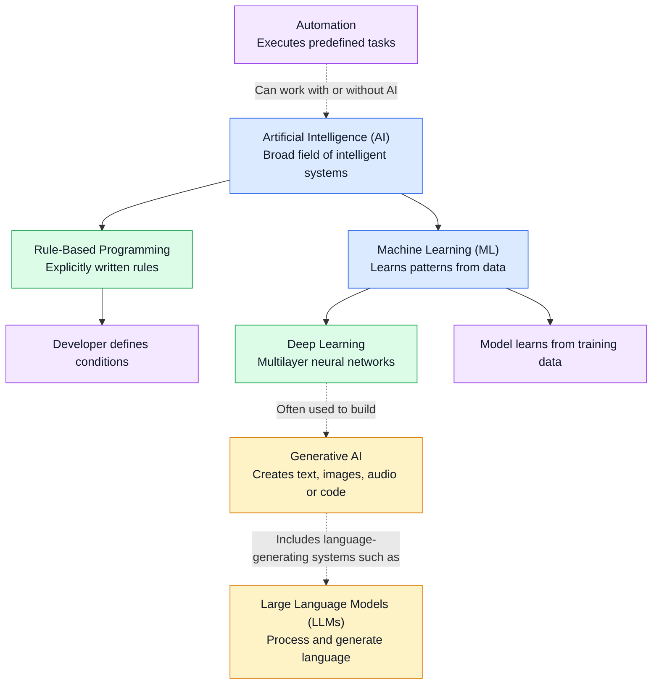

# Mission 1 — AI and ML Mental Map

## Concept Map

## Key Takeaways

1. AI is the broad field; ML is one approach within AI.
2. Rule-based programming follows explicitly written conditions.
3. ML learns patterns from data.
4. Deep learning is a subset of ML that uses multilayer neural networks.
5. Generative AI creates new content.
6. LLMs focus on processing and generating language.
7. Automation does not necessarily require AI or ML.

## Engineering Example

- **Rule-based:** Flag a chip timing violation when delay exceeds a specified limit.
- **Machine learning:** Predict timing pass/fail from historical design measurements.
- **Generative AI:** Generate a natural-language explanation of a Verilog module.

## Important Note

This is a simplified conceptual map. Generative AI is a capability, while deep learning is a learning approach and LLMs are language-focused models. They should not be treated as separate categories at exactly the same level.
